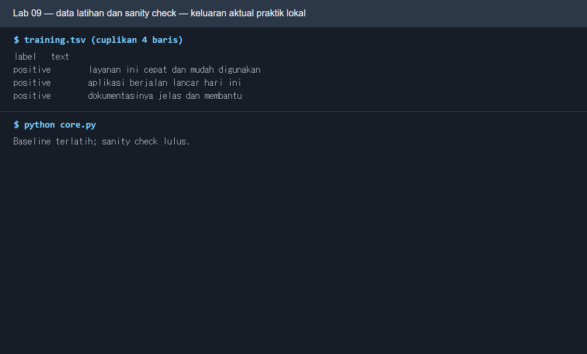
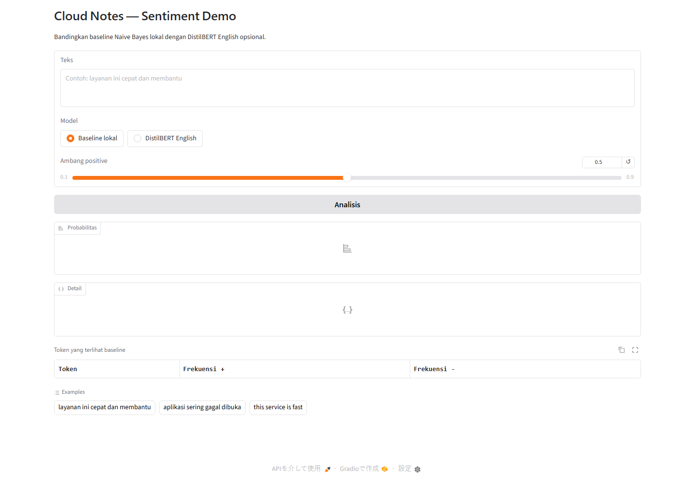
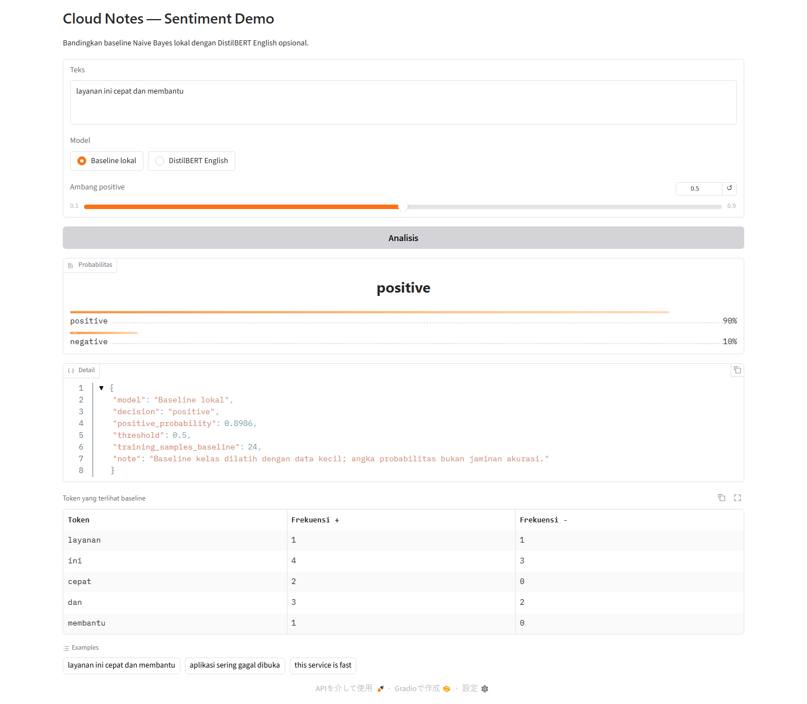
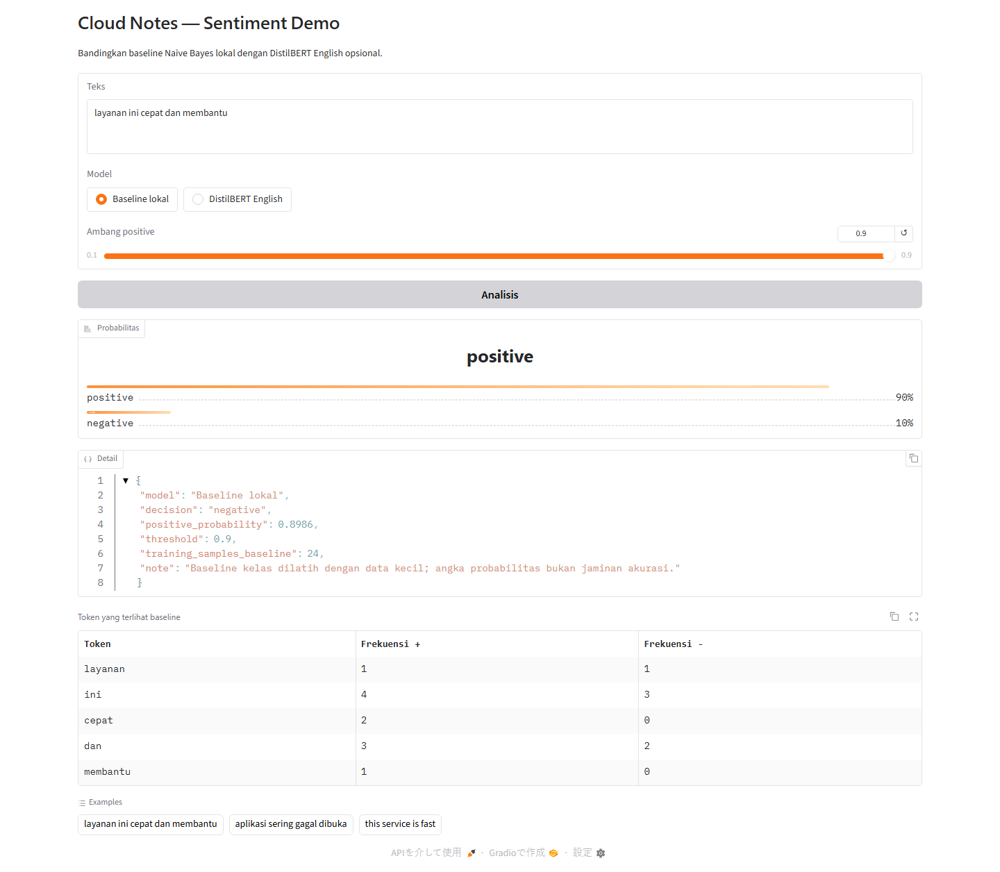

# Lab 09 — UI sentiment dengan Gradio lokal

**Kebijakan kelas:** Lab ini latihan formatif, tanpa tugas, nilai, atau penyerahan terpisah. Satu proyek besar dikerjakan oleh kelompok **3 orang**, dengan presentasi checkpoint minggu 7 (UTS) dan hasil akhir minggu 14 (UAS). Simpan hasil lab hanya bila berguna sebagai referensi atau bukti proses proyek. Baca [brief proyek kelompok](PROYEK_KELOMPOK.md). Bobot resmi tetap mengikuti RPS/LMS.

**Subtopik RPS:** UI Gradio, prediksi sentiment, perbandingan model, deployment Spaces, dan integrasi iframe. Jalur kelas menjalankan baseline di laptop. DistilBERT dan Spaces tersedia sebagai perluasan setelah jalur lokal selesai.

Panduan ini memakai **Windows PowerShell**. Jalankan satu baris perintah setiap kali, lalu baca hasilnya sebelum lanjut. Internet diperlukan untuk clone dan pemasangan pertama. Server lokal tetap berjalan di terminalnya sampai dihentikan dengan `Ctrl+C`.

**Bukti latihan opsional:** screenshot yang tersedia menunjukkan contoh hasil pengujian sebelumnya. Angka waktu dan probabilitas pada komputer Anda dapat berbeda. Gambar terminal berlatar gelap adalah teks keluaran aktual yang ditata ulang agar terbaca, bukan screenshot terminal langsung. Simpan hasil Anda sendiri untuk referensi proyek bila berguna. Tidak ada laporan atau push terpisah yang wajib dikumpulkan.

## 1. Clone dan buka folder praktikum

Pasang Python 3.10 atau lebih baru dan Git. Buka PowerShell pada folder tempat Anda menyimpan praktikum, lalu jalankan:

```powershell
git clone https://github.com/SeedFlora/meet9CloudService.git meet9CloudService-local
cd .\meet9CloudService-local
Get-Location
python --version
```

Hasil `Get-Location` berakhir dengan `meet9CloudService-local`. Perintah berikut selalu dijalankan dari folder ini. Untuk repo yang sudah ada, buka folder repo tersebut dan lanjut ke langkah 2.

## 2. Pasang paket dan periksa model

```powershell
python -m venv .venv
.\.venv\Scripts\python -m pip install -r requirements.txt
.\.venv\Scripts\python core.py
```

Venv memisahkan paket lab dari Python lain. Tidak perlu mengaktifkan venv atau mengubah execution policy. `core.py` memuat `training.tsv`, melatih Naive Bayes kecil, lalu menampilkan **sanity check lulus**. Data dua label ini hanya baseline latihan, bukan bukti akurasi produksi.



*Baca gambar:* data memiliki label positive/negative dan pemeriksaan model selesai sebelum server UI dinyalakan.

## 3. Jalankan Gradio di Terminal 1

```powershell
.\.venv\Scripts\python app.py
```

Biarkan terminal ini terbuka. Buka **http://127.0.0.1:7860**. Anda melihat Textbox, Radio model, Slider ambang, Button, Label probabilitas, JSON detail, Dataframe token, Markdown, dan Examples.



*Baca gambar:* masukkan teks di kotak atas, pilih Baseline lokal, lalu gunakan tombol Analisis.

## 4. Coba prediksi dan ambang

1. Pilih **Baseline lokal**, ambang **0,5**, masukkan `layanan ini cepat dan membantu`, lalu klik **Analisis**. Baca probabilitas dan `Detail.decision`.
2. Ganti teks menjadi `aplikasi sering gagal dibuka`. Bandingkan label, probabilitas, dan tabel token.
3. Pakai lagi teks positif, ubah ambang menjadi **0,9**, lalu Analisis. Probabilitas model tetap sama. `Detail.decision` dapat menjadi negative karena aturan ambang berubah. Panel Probabilitas tetap mengurutkan skor tertinggi.
4. Kosongkan teks dan klik Analisis. Panel Detail meminta teks diisi, lalu UI tetap dapat digunakan.



*Baca gambar:* probabilitas menyatakan skor model. Keputusan di Detail menerapkan ambang yang dipilih.



*Baca gambar:* skor sekitar 0,8986 belum mencapai ambang 0,9. Nilai mesin atau versi data Anda dapat berbeda.

## 5. Periksa kode dari Terminal 2

Buka terminal PowerShell kedua pada folder repo yang sama. Terminal 1 tetap menjalankan Gradio.

```powershell
Get-Content .\training.tsv
.\.venv\Scripts\python -B tests\challenge.py
```

Pemeriksa menguji baseline, aturan ambang, validasi input, dan kontrak keluaran. Hasil yang diharapkan **9 PASS, 0 FAIL**. Temukan fungsi `analyze` di `app.py`: Gradio mengirim input ke fungsi ini, lalu mengisi tiga panel output.

## 6. Selesai dan diskusi

Hentikan Gradio di Terminal 1 dengan `Ctrl+C`. Jelaskan beda data latih, inferensi, probabilitas, dan keputusan. Mengapa model kecil ini belum cukup untuk mengevaluasi sentiment pengguna sungguhan?

DistilBERT memakai model berbahasa Inggris, paket tambahan, dan unduhan checkpoint. Langkah perluasan ada di [README](README.md). Deployment Spaces dan iframe juga opsional sesuai akses akun. [Panduan Git](PANDUAN_GIT.md) hanya dipakai untuk menyimpan source proyek. `.venv`, cache model, token, dan data pribadi tidak boleh masuk Git.
